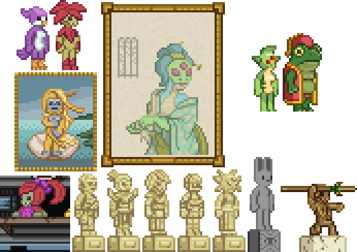

Chucklefish forums died, possibly forever, so i decided to start dumping some of the Starbound mods I've released there on Github at least. To download, click the "Code" button at the top, then click Download zip, extract the mod's folder out of the zip, then paste the folder into Starbound's mod directory. Some of the original mod names or descriptions might have been edited a little.

This mod does a bunch of tweaks to vanilla species' sprites, alonsgide corresponding objects and other stuff.

